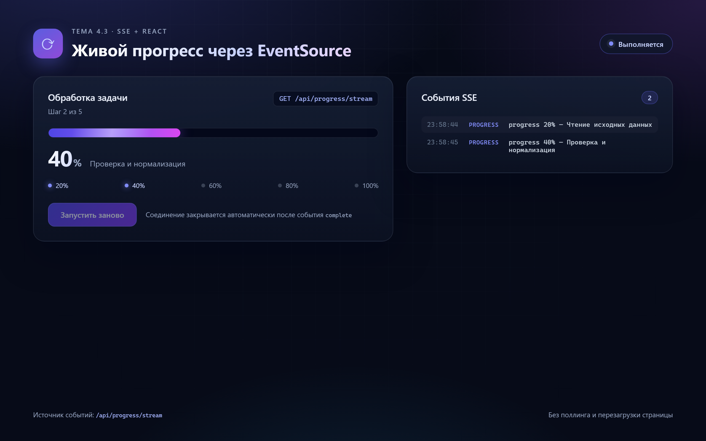
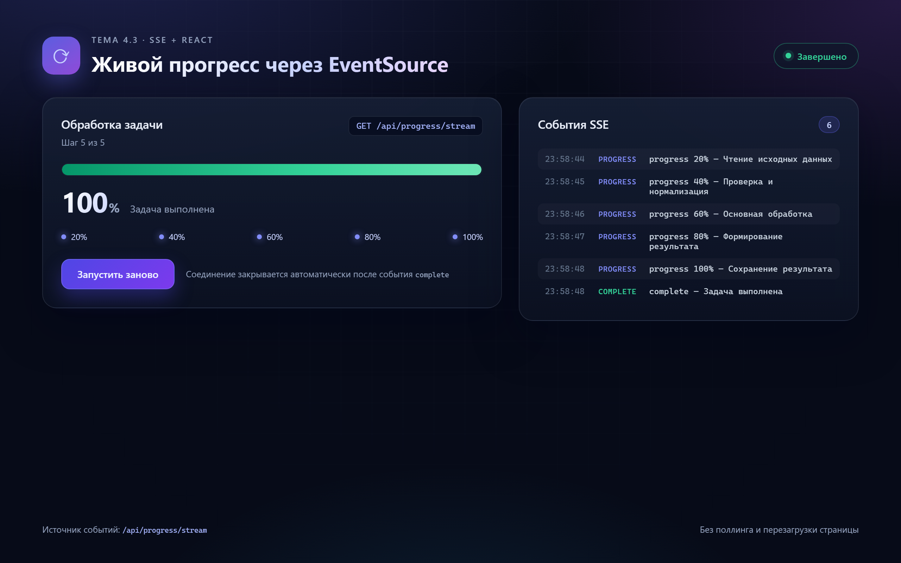
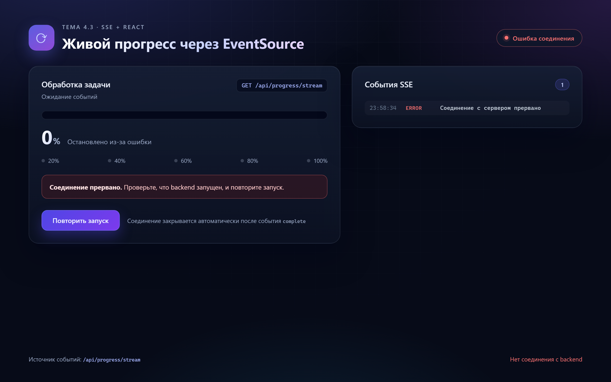

# SSE Progress — практическое задание 4.3

Live-обновление прогресса: FastAPI отправляет поток Server-Sent Events, React
отображает прогресс через `EventSource` — без поллинга и перезагрузки страницы.

## Структура проекта

```
sse-progress-app/
├── backend/
│   ├── main.py            # FastAPI + SSE-эндпоинт /api/progress/stream
│   └── requirements.txt
├── frontend/
│   ├── src/
│   │   ├── App.jsx
│   │   ├── hooks/useProgressStream.js   # EventSource, addEventListener, close
│   │   ├── components/ProgressPanel.jsx # индикатор прогресса
│   │   ├── components/EventLog.jsx      # журнал событий
│   │   ├── components/StatusBadge.jsx   # статус соединения
│   │   └── styles.css
│   ├── vite.config.js     # прокси /api -> http://127.0.0.1:8010
│   └── package.json
├── run-backend.cmd
└── run-frontend.cmd
```

## Запуск

Нужны два терминала. Порты: backend — **8010**, frontend — **5180**
(выбраны свободными; при необходимости поменяйте их в `vite.config.js` и в
команде запуска uvicorn).

### 1. Backend (FastAPI, порт 8010)

```powershell
cd sse-progress-app
python -m venv .venv
.venv\Scripts\Activate.ps1          # Windows PowerShell
pip install -r backend\requirements.txt
uvicorn main:app --reload --port 8010 --app-dir backend
```

Проверка потока напрямую:

```powershell
curl.exe -N http://127.0.0.1:8010/api/progress/stream
```

В ответ приходят 5 событий `event: progress` (20 → 100 %) и одно `event: complete`.

### 2. Frontend (React + Vite, порт 5180)

```powershell
cd frontend
npm install
npm run dev
```

Открыть <http://localhost:5180> — прогресс начнёт расти сразу после загрузки
страницы, соединение закроется автоматически на событии `complete`.

Быстрый старт в Windows: `run-backend.cmd`, затем `run-frontend.cmd`.

## Скриншоты

| Процесс | Завершение | Обрыв соединения |
|---|---|---|
|  |  |  |

## Как реализованы требования

| № | Требование | Где реализовано |
|---|------------|-----------------|
| 1 | 5 событий `progress` (20, 40, 60, 80, 100) + `complete` | `backend/main.py`: `STEPS`, `progress_generator` |
| 2 | Именованные события `event: progress` / `event: complete` | `sse_event(...)` → `EventSourceResponse`; sse-starlette формирует корректный SSE-формат |
| 3 | `EventSource` создаётся в `useEffect` с массивом зависимостей | `frontend/src/hooks/useProgressStream.js`, `useEffect(..., [url, runId, appendLog])` |
| 4 | `addEventListener` для обоих типов событий, без `onmessage` | там же: `eventSource.addEventListener('progress', ...)`, `('complete', ...)` |
| 5 | Визуальный индикатор в реальном времени | `ProgressPanel.jsx`: полоса `role="progressbar"`, проценты, отметки шагов |
| 6 | `close()` при `complete` и в cleanup `useEffect` | `closeConnection()` вызывается в `handleComplete` и в `return () => ...` |
| 7 | `onerror` с понятным сообщением | `eventSource.onerror` → статус «Ошибка соединения», алерт с текстом и кнопка «Повторить запуск» |

Дополнительно: backend поддерживает keep-alive `ping=15`, отключает буферизацию
(`X-Accel-Buffering: no`), проверяет отключение клиента через
`request.is_disconnected()`; CORS разрешён для `http://localhost:5173` и
`http://localhost:5180`, поэтому `EventSource` можно направить и напрямую на
backend, задав `VITE_API_BASE_URL=http://127.0.0.1:8010` в
`frontend/.env.local`.

## Стек

- Python 3.12, FastAPI, sse-starlette, uvicorn
- React 18, Vite 5, EventSource API
